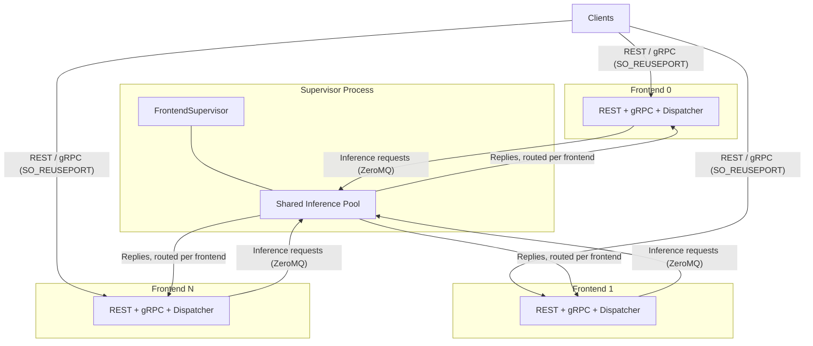

# Parallel Inference

Out of the box, MLServer includes support to offload inference workloads to a
pool of workers running in separate processes.
This allows MLServer to scale out beyond the limitations of the Python
interpreter.
To learn more about why this can be beneficial, you can check the [concurrency
section](#concurrency-in-python) below.


By default, MLServer will spin up a pool with only one worker process to run
inference.
All models will be loaded uniformly across the inference pool workers.
To read more about advanced settings, please see the [usage section
below](#usage).

## Concurrency in Python

The [Global Interpreter Lock
(GIL)](https://wiki.python.org/moin/GlobalInterpreterLock) is a mutex lock that
exists in most Python interpreters (e.g. CPython).
Its main purpose is to lock Python’s execution so that it only runs on a single
processor at the same time.
This simplifies certain things to the interpreter.
However, it also adds the limitation that a **single Python process will never
be able to leverage multiple cores**.

When we think about MLServer's support for [multi-model serving via the Model
Repository](../examples/model-repository/README.md), this could lead to scenarios where a
**heavily-used model starves the other models** running within the same
MLServer instance.
Similarly, even if we don't take multi-model serving into account, the **GIL also makes it harder
to scale inference for a single model**.

To work around this limitation, MLServer offloads the model inference to a pool
of workers, where each worker is a separate Python process (and thus has its
own separate GIL).
This means that we can get full access to the underlying hardware.

### Overhead

Managing the Inter-Process Communication (IPC) between the main MLServer
process and the inference pool workers brings in some overhead.
MLServer manages worker processes through `multiprocessing` and uses
`multiprocessing.Queue` for inference messages by default. The optional ZeroMQ
transport changes inference IPC while retaining queues for model control.
Both transports serialize requests and responses. See
[Inference Performance Options](./performance.md) for configuration and the
related REST and gRPC conversion options.

IPC overhead can be **particularly noticeable for lightweight inference
methods**, where it can take a large percentage of the overall time.
In these cases (which can only be assessed on a model-by-model basis), the user
has the option to [disable the parallel inference feature](#usage).

For regular models where inference can take a bit more time, this overhead is
usually offset by the benefit of having multiple cores to compute inference on.

## Usage

By default, MLServer will always create an inference pool with one single
worker.
The number of workers (i.e. the size of the inference pool) can be adjusted
globally through the server-level `parallel_workers` setting.

### `parallel_workers`

The `parallel_workers` field of the `settings.json` file (or alternatively, the
`MLSERVER_PARALLEL_WORKERS` global environment variable) controls the size of
MLServer's inference pool.
The expected values are:

- `N`, where `N > 0`, will create a pool of `N` workers.
- `0`, will disable the parallel inference feature.
  In other words, inference will happen within the main MLServer process.

## Multi-Frontend Serving

The REST and gRPC frontends of a single MLServer process can become the
bottleneck at high request rates, since request parsing and response
serialisation share one Python process (and its GIL) with the inference
dispatch loop.
The `frontend_workers` setting scales that layer across multiple
processes while keeping a single copy of every model in memory.

```json
{
  "frontend_workers": 4,
  "parallel_workers": 2,
  "parallel_inference_transport": "zmq"
}
```

### How it works

At `frontend_workers = 1` (the default) nothing changes: MLServer runs
as a single process exactly as before.
At `N > 1`, a supervisor process:

- spawns `N` frontend processes, all serving REST and gRPC on the same
  ports (kernel-level `SO_REUSEPORT` connection balancing),
- owns the single shared inference pool, so every model exists once in
  memory regardless of the frontend count, and
- coordinates model loads and unloads across the frontends: a model
  loaded through any frontend becomes servable on all of them, and the
  load call returns only after every frontend has applied it.



### Requirements and behaviour

- Requires `parallel_workers >= 1` and
  `parallel_inference_transport = "zmq"` (validated at startup; the
  queue transport is parent-child and cannot be shared).
- Adaptive batching is unaffected: batchers live in the inference
  workers, so batch formation always sees the full traffic rate for a
  model no matter how many frontends receive the requests.
- Each frontend exposes the same `/metrics` endpoint backed by
  [Prometheus multiprocess mode](./metrics.md); scraping any frontend
  reports server-wide totals.
- Every REST response carries an `x-mlserver-frontend-id` header
  identifying the frontend process that served it — useful to verify
  the SO_REUSEPORT connection distribution from the client side.
- A crashed frontend is restarted automatically (with capped
  exponential backoff) and receives the full model registry again.
- On shutdown the frontends drain in-flight requests first; the
  inference workers stop afterwards.
- On Linux, all child processes terminate automatically if the
  supervisor is killed.
- Model operations return within `model_operation_timeout` (default 60
  seconds): the pool load/unload plus every frontend's apply and
  acknowledgement. The same timeout also bounds control-pipe delivery
  (including restart replay sends): tuning it down aggressively can
  burn restart budgets during slow replays. Crashed frontends restart with exponential backoff
  (1s doubling, capped at 16s), giving up after `frontend_max_restarts`
  (default 5) attempts per frontend.
- Inference requests wait for their reply without a deadline by
  default (matching unbounded model execution times). Setting
  `inference_timeout` bounds the wait per request: a reply dropped in
  flight (for example, a frontend that stopped receiving) fails the
  request with a timeout instead of leaving its connection hung
  forever. Set it comfortably above your slowest model plus batch
  window.

### `frontend_workers`

The `frontend_workers` field of the `settings.json` file (or the
`MLSERVER_FRONTEND_WORKERS` environment variable) controls the number of
frontend processes.
The expected values are:

- `N`, where `N > 1`, enables the multi-process topology described
  above (`N` is capped at `64`).
- `1` (the default) keeps the original single-process behaviour.

Two operational consequences of the shared-port topology are worth
knowing: because every frontend binds the same ports
(`SO_REUSEPORT`), a readiness probe that samples a single connection
lands on one frontend at a time — a degraded frontend is only visible
to a fraction of probes, so probe repeatedly or through a load
balancer that spreads connections. And batched models rotate their
dedicated worker every `parallel_routing_rotation` seconds (default
1.0) to keep execution spread, so a batch window can straddle a
rotation boundary during worker failure recovery.

### `parallel_routing_rotation`

Batched models (see [Adaptive Batching](./adaptive-batching.md)) route
all requests for a model to a single worker so that its batcher sees
the full traffic rate; the assignment rotates across workers over time
to preserve execution spread.
`parallel_routing_rotation` (seconds, default `1.0`) controls the
rotation period; `0` pins assignments statically.
Keep this at least a few times larger than the model's `max_batch_time`
so batch windows are not fragmented across rotation boundaries.
Models without batching always use round-robin routing.
